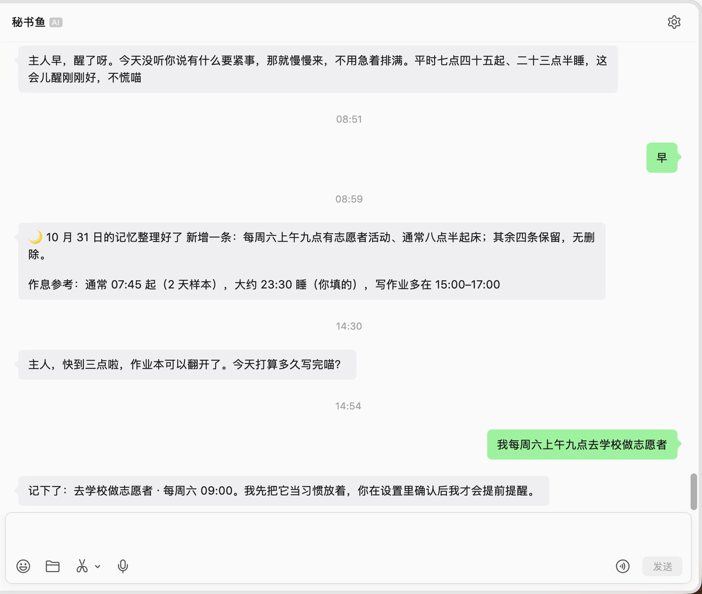

# 秘书鱼 · mishu-fish

> Secretary Fish — 一个住进微信里的私人秘书，DeepSeek Harness 插件。

微信里的私人秘书。用**腾讯 iLink Bot API**（ClawBot 官方通道）接入一个机器人账号，在 DSH 的设置里改她的人设、语气和行为。

- 设置 → **秘书鱼**：状态、人设、表达、行为、习惯、作息、日程、记忆、模型、日志
- 长轮询收消息，直连 DSH 的模型服务生成回复（复用 DSH 的 provider 与凭证）
- 凭据、游标、会话令牌都落本地文件，重启能续读
- 只支持单聊（iLink 的能力边界，群聊不投递）

> ⚠️ **这是非官方接口**：iLink Bot API 没有公开文档与稳定性承诺，随时可能改协议或限制账号。用它意味着你接受这个风险。项目不提供任何账号、不代登录、不收集你的数据。

## 〇、下载

- 发布页（推荐）：`https://github.com/YOUR_NAME/mishu-fish/releases`
- 项目主页：`https://YOUR_NAME.github.io/mishu-fish/`（`docs/index.html`）
- 直接克隆：`git clone https://github.com/YOUR_NAME/mishu-fish.git`

README 里的 `YOUR_NAME` 换成你的 GitHub 用户名即可。

## 平台支持

| 系统 | 状态 |
|---|---|
| macOS | 已实测（开发环境） |
| Windows | 理论可用，未实测：需要 DSH 提供 Windows 版；通知兜底走 PowerShell 气泡提示 |
| Linux | 理论可用，未实测：需要 DSH 可用；通知走 `notify-send` |

代码本身不依赖系统（Node 24 + 一个 `qrcode` 依赖），只有三处与平台有关：

1. **系统通知**：macOS 用 `osascript`，Windows 用 PowerShell，Linux 用 `notify-send`（已适配）
2. **二维码自动打开**：只在 macOS 生效，其它系统会把路径打印出来让你自己开
3. **`bin/mishu` 启动器**：bash 脚本，Windows 请直接用 `node src/cli/login.ts`

真正的限制是 **DSH**：本插件是它的扩展，DSH 跑不起来这里一切都无从谈起。

## 一、装成 DSH 插件

```bash
cd mishu-fish
pnpm build             # 把 src/ 编译到 dist/
```

然后在 DSH 里装上（任选其一）：

```bash
# 有 dsh CLI 的话
dsh plugin --profile desktop add "link:<你的本地路径>/mishu-fish"
```

没有 CLI 就手工两步——编辑 `~/.dsh/profiles/desktop/package.json`：

```json
{
  "dependencies": { "mishu-fish": "link:<你的本地路径>/mishu-fish" },
  "dsh": { "profile": { "bundles": ["@deepseek-ai/dsh-base", "@deepseek-ai/dsh-web-app", "mishu-fish"] } }
}
```

再在 `~/.dsh/profiles/desktop` 里跑一次 `pnpm install`，然后**重启 DSH**。

装好后：设置里出现「秘书鱼」。第一次用先在项目里跑 `pnpm login` 扫码，凭据会写到 `~/.dsh/mishu-fish/`（只在本机，权限 0600）。

> 装了插件就把 `./bin/mishu echo` 停掉：两边同时长轮询会各回一遍（状态文件不同，去重挡不住跨进程）。

## 二、截图



## 三、设置页里有什么

| 区块 | 字段 |
|---|---|
| 开关 | 启用（关掉后仍收消息但不回复） |
| 人设 | 名字、自称、怎么叫你、起点模板、人格正文、不许用的词 |
| 表达 | 回复长度上限、表情、语言、Markdown |
| 行为 | 每条都回、免打扰时段（可跨零点）、每分钟上限、模型失败兜底话术 |
| 模型 | 继承 DSH 默认 / 手动指定 provider+model、temperature、maxTokens |
| 日志 | 最近 100 条收发（← 收到 / → 回复 / ! 系统），可清空 |

改完点「保存」，下一条消息就生效，不用重启。

## 四、命令行（调试用）

```bash
./bin/mishu login      # 扫码创建机器人账号（本地页面自动刷新二维码）
./bin/mishu echo       # 监听并复读，验证收发链路
./bin/mishu send "..." # 主动发一条（验证 24h 会话窗口）
./bin/mishu status     # 账号、游标、令牌年龄
```

`login` 会在 `http://127.0.0.1:8787` 起一个页面，二维码每 2 分钟自动刷新——别截图扫，会过期。

## 五、记忆

```
~/.dsh/mishu-fish/memory/
  YYYY-MM-DD.jsonl   当天的原文，只追加，不删
  facts.md           事实卡：长期成立的“你是谁”，可手改
```

- 每条消息固定带 **最近 8 条原文 + 事实卡**（可在设置里改）
- 转后台的记录单独存 `scope=agent`，不与聊天混在一起
- 原文永不删除；进上下文的只有压缩层
- 设置页能看到「每条消息约 +N token」的实时估算

**还没做**（规划中）：每日 05:00 摘要、凌晨日报、提醒、习惯统计。设置页里对应字段已占位并标注“下一步上线”。

## 六、版本约定

- `package.json` 的版本号是**构建号**，每次改动递增（0.10.3、0.10.4 …），`boot.log` 会打印它
- 对外简报只写**大版本**（0.1.0、0.2.0 …），一天一个大版本，当天所有构建都属于它
- 排查“跑的是不是最新代码”请看 `boot.log` 的 `v=` 和 `dist=`，不要看简报

## 七、待做（已评估、暂缓）

按优先级记录，避免下次重新讨论：

1. **媒体收发** —— 出站文件/图片（getuploadurl + AES-128-ECB + CDN）、入站下载解密。协议支持，未实现；`aes_key` 有两种编码形式，是主要坑。
2. **媒体收发** —— 出站文件/图片（getuploadurl + AES-128-ECB + CDN）、入站下载解密。协议支持，未实现；`aes_key` 有两种编码形式，是主要坑。
3. **群聊** —— iLink 不投递群事件，等平台支持。
4. **习惯统计 / 预测** —— 按天记话题与时段，纯计数不做推断。
5. **日程的自然语言改期** —— 「报告改到周日」，需要可靠定位到具体某条。
6. **秘书鱼自我迭代 / 共情演进** —— 让摘要里的“评价”反过来影响人设，用户明确想以后做。

## 八、数据与隐私

```
~/.dsh/mishu-fish/
  credentials.json   bot_token / bot 账号 / 授权微信   0600
  config.json        人设与行为配置
  state.json         游标 + 每个用户的 context_token + 去重记录
  qrcode.png         登录二维码（登录后可删）
  mishu.log          登录与状态日志
```

项目内 `.data/` 是 CLI demo 的旧目录，`.gitignore` 已忽略。

**不要把 credentials.json 发出去**：它就是机器人身份。

## 九、已知边界

1. **24 小时窗口**：iLink 没有"发起会话"的接口，回复必须带最近一条入站消息的 `context_token`。超过 24 小时没互动，她就发不出消息，直到你先说一句。设置页会显示窗口剩余时间。
2. **群聊不可用**：iLink 不投递群事件。
3. **发送有上限**：2026-10-30 实测，连续发 11 条「你好」，前 9 条成功，第 10、11 条被拒（`ret=-2 prepare failed`）；等 20 秒、换内容仍失败。规则应是“对方回一条才能继续发”，具体条数边界（9 还是 10）待再测。
4. **语音出站不支持**；入站语音自带腾讯转好的文字，可以直接用。
5. **会话失效（ret=-14）**：需要重新扫码，`pnpm login --force`，然后设置页点「重新读取凭据」。
6. **`!dsh` 默认关闭**：它能让微信消息在你电脑上执行命令，风险很高。要用自己去设置里打开。

## 十、开发

```bash
pnpm build       # src → dist（插件宿主加载 dist）
pnpm typecheck   # tsc --noEmit
pnpm test        # 173 个用例，不需要真实扫码
# 发布前手动走一遍：docs/SMOKE.md
```

```
src/
  ilink/      协议层：扫码、长轮询、发消息、typing
  plugin/     config / persona / reply / bridge / runtime
  cli/        login / echo / status / send
  store.ts    凭据与状态原子读写（0600）
  text.ts     文本提取与 2000 字分片
lib/
  index.js    宿主半边：路由 + 信任栅栏 + 生命周期
  client.js   客户端半边：设置 → 秘书鱼
tests/        协议、配置、人设、回复、桥接、接线
```

协议参考：[Tencent/openclaw-weixin](https://github.com/Tencent/openclaw-weixin)、[protocol-spec.md](https://github.com/epiral/weixin-bot/blob/main/docs/protocol-spec.md)
